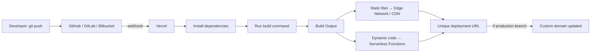
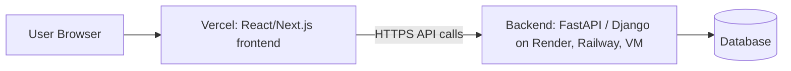

---
created:
tags:
type: Self help
---
---

---
title: Vercel
aliases: [Vercel Platform, Vercel Hosting]
tags: #deployment, #hosting, #frontend, #serverless, #cloud, #devops
type: topic-note
status: complete
created: 2026-10-18

related: ["[[Next.js]]", "[[Serverless]]", "[[CDN]]", "[[CI-CD]]", "[[Git]]", "[[DNS]]", "[[Netlify]]", "[[Cloudflare Pages]]"]

---

# Vercel

> [!abstract] One-line summary
> **Vercel is a cloud platform that takes your code from a Git repository, builds it, and puts it live on a global network, with HTTPS, a CDN, serverless backend code, and a preview link for every change, and almost no server setup on your part.**

> [!warning] Verify numbers
> Prices and limits below reflect the platform as of roughly **mid/late 2026**. They change often. Always confirm at `vercel.com/pricing` and `vercel.com/docs/limits` before relying on a specific number.

---

## 1. What is Vercel?

Vercel is a **Platform-as-a-Service (PaaS)**, often described as a "frontend cloud". You give it a project (website, web app, API routes), and it handles:

- **Building** your project (running `npm run build` or equivalent)
- **Hosting** the output on servers around the world
- **Serving** it through a **CDN** (Content Delivery Network) for speed
- **Running backend code** as **serverless functions** (no server to manage)
- **HTTPS/SSL certificates**, **domains**, **previews**, **rollbacks**, **monitoring**

Think of it as: *"`git push` → website is live in about a minute."*

### Who makes it?
- Company: **Vercel Inc.**, founded by **Guillermo Rauch**.
- Originally called **ZEIT** (2015), renamed to **Vercel** in **2020**.
- Vercel is also the creator and main maintainer of **[[Next.js]]**, the most popular React framework. This is why Next.js works best on Vercel (new Next.js features usually land there first).

### Why does it exist? (the problem it solves)

| Without Vercel (traditional hosting)            | With Vercel                      |
| ----------------------------------------------- | -------------------------------- |
| Rent a server (VPS), install Linux, Nginx, Node | No server to manage              |
| Configure SSL certificates manually             | Automatic HTTPS                  |
| Set up CI/CD pipeline yourself                  | Built-in: push to Git = deploy   |
| Add a CDN separately                            | CDN included globally            |
| Scale manually when traffic spikes              | Auto-scales                      |
| Test changes on a shared staging server         | Unique preview URL per branch/PR |
| Rollbacks = redeploy old code manually          | One-click instant rollback       |

---

## 2. Core Concepts (the vocabulary)

### 2.1 Project
A **Project** is one app/site linked to a Git repository (or uploaded via CLI). It holds settings: framework, build command, env variables, domains, etc.

### 2.2 Deployment
A **Deployment** is one built, live version of your project. Every `git push` creates a new deployment. Deployments are **immutable**: once created, they never change. That's what makes instant rollbacks possible (you just point the domain at an older deployment).

### 2.3 Environments

| Environment | Triggered by | URL | Purpose |
|---|---|---|---|
| **Production** | Push/merge to the *production branch* (usually `main`) | Your custom domain (e.g. `myapp.com`) + `*.vercel.app` | The real live site |
| **Preview** | Push to any *other* branch or open a Pull Request | Unique URL like `myapp-git-feature-x-team.vercel.app` | Test and review before merging |
| **Development** | Local, via `vercel dev` / `vercel env pull` | `localhost` | Local dev using Vercel's env vars |
| **Custom environments** (paid plans) | Your own, e.g. `staging` | Custom | Long-lived staging environments |

> [!tip] Preview deployments are the killer feature
> Every Pull Request gets its own live URL. Teammates, designers, and clients can click and review the actual running app, not screenshots. Vercel's bot comments the link right on the PR.

### 2.4 Edge Network (Global CDN)
Vercel copies your static files (HTML, CSS, JS, images) to many locations worldwide ("**edge locations / Points of Presence**"). A user in Germany is served from a nearby location instead of one central server in the US, giving lower latency and faster load times.

### 2.5 Regions
Your **serverless functions** run in a specific **region** (e.g. `iad1` = Washington DC, `fra1` = Frankfurt, `cdg1` = Paris). Choose a region **close to your database**, because function-to-database latency matters more than user-to-function latency.

### 2.6 Serverless
"Serverless" doesn't mean no servers. It means **you don't manage them**. Your code runs only when a request comes in, and you're billed for usage, not for idle time. See [[Serverless]].

---

## 3. How Vercel Works (the pipeline)



**Step by step:**
1. You push code to Git.
2. The Git provider notifies Vercel (webhook).
3. Vercel clones the repo in an isolated **build container**.
4. It detects your **framework** (Next.js, Vite, Astro, etc.) and picks default settings.
5. It installs dependencies (`npm install` / `pnpm` / `yarn` / `bun`).
6. It runs the **build command**.
7. Output is split: **static assets** go to the CDN, and **dynamic routes** become **serverless functions**.
8. A unique URL is generated. If it was the production branch, your domain is switched to this new deployment, **atomically**, so there is no downtime.

---

## 4. Supported Frameworks and Languages

### Frontend frameworks (zero-config or near zero-config)
- **[[Next.js]]** (first-class support)
- React (Vite, Create React App), Vue / Nuxt, Svelte / SvelteKit, Astro, Remix / React Router, Angular, Gatsby, Solid, Qwik
- Plain static HTML/CSS/JS

### Backend / serverless runtimes
- **Node.js** (most common), **Python**, **Go**, **Ruby**, **Bun**, and an **Edge runtime** (lightweight, V8-based).
- Python apps (e.g. **FastAPI**, Flask, Django) can run on Vercel as serverless functions, but they work best for short, stateless request/response APIs.

> [!note] Build Output API
> Vercel defines a standard format (`.vercel/output`) that any framework can produce. That's how new frameworks get first-class support without Vercel hard-coding each one.

---

## 5. Compute: How Backend Code Runs

### 5.1 Vercel Functions (Serverless Functions)
- Files in an `api/` folder (or framework route handlers such as Next.js `app/api/.../route.ts`) become HTTP endpoints.
- Each request runs your code in a short-lived container; there are **cold starts** (first request after idle is slower).
- Limits apply: **max duration**, **memory**, **request/response body size**, **bundle size**. These vary by plan.

Example (plain Node function, `api/hello.js`):
```js
export default function handler(req, res) {
  res.status(200).json({ message: "Hello from Vercel!" });
}
```

### 5.2 Fluid Compute
Vercel's newer execution model (introduced 2025). Instead of one container per request, one function instance can **handle multiple concurrent requests** and reuse resources, with fewer cold starts and better cost efficiency, especially for I/O-heavy work like **AI/LLM calls and database calls**. It also allows longer maximum durations.

### 5.3 Edge Functions / Middleware
- Run **before** a request reaches your app, at edge locations close to the user.
- Very fast start, but a **restricted runtime** (no full Node.js APIs).
- Typical uses: **auth checks, redirects, rewrites, A/B testing, geolocation, bot filtering, header manipulation**.

### 5.4 Comparison

| | Serverless/Fluid Function | Edge Function / Middleware |
|---|---|---|
| Runtime | Full Node.js / Python / Go... | Lightweight Edge (V8) |
| Location | Chosen region | Globally distributed |
| Startup | Slower (cold start possible) | Very fast |
| Capabilities | Full libraries, DB drivers, file system (read-only) | Limited APIs |
| Best for | API logic, DB work, AI calls | Auth gates, redirects, personalization |

### 5.5 Cron Jobs
Schedule a function to run periodically using a cron expression in `vercel.json`:
```json
{
  "crons": [
    { "path": "/api/cleanup", "schedule": "0 3 * * *" }
  ]
}
```
Vercel calls that path on schedule. Frequency and count limits depend on plan.

### 5.6 What Vercel is **not** great for
> [!failure] Poor fit
> - **Long-running processes** (video processing, big training jobs, long ML inference)
> - **Persistent connections** like classic WebSocket servers (use a separate service such as Pusher, Ably, or a dedicated server)
> - **Stateful servers** that keep data in memory or on local disk (function disk is ephemeral)
> - **Large file uploads** passing through functions (request body size limits; upload directly to storage instead)
> - Heavy always-on **background workers**

---

## 6. Rendering Strategies (very important for Next.js on Vercel)

| Strategy | Full name | When HTML is generated | Good for |
|---|---|---|---|
| **SSG** | Static Site Generation | At **build time** | Blogs, docs, marketing pages |
| **SSR** | Server-Side Rendering | On **every request** | Personalized or live data pages |
| **ISR** | Incremental Static Regeneration | Static, but **re-generated in background** after N seconds or on demand | Product pages, news; the best of both |
| **CSR** | Client-Side Rendering | In the **browser** | Dashboards, SPAs |
| **PPR** | Partial Prerendering | Static shell + dynamic holes streamed in | Fast first paint with dynamic parts |

> [!tip] ISR in plain words
> The page is served instantly from cache (like static). After a set time, the next visitor triggers a quiet rebuild in the background. The following visitors get the fresh version. No full-site rebuild required.

---

## 7. Domains, DNS and HTTPS

- Every project gets a free `project-name.vercel.app` domain.
- **Add a custom domain** in *Project → Settings → Domains*.
- Two ways to connect:
  1. **Nameservers**: point your domain's nameservers to Vercel (Vercel manages all DNS).
  2. **DNS records**: keep your DNS provider and add an `A` record (apex domain such as `example.com`) or a `CNAME` (subdomain such as `www.example.com`) pointing to the values Vercel shows.
- **SSL/TLS certificates** are issued and renewed **automatically** (Let's Encrypt).
- **Redirects** (e.g. `www` → apex) and **wildcard domains** are supported.
- You can also **buy domains** directly through Vercel.

See [[DNS]] for the underlying concepts (A, CNAME, NS records).

---

## 8. Environment Variables and Secrets

Environment variables store configuration such as API keys, DB URLs, and tokens, **outside** your code.

- Set in **Project → Settings → Environment Variables**, or via CLI.
- Scope each variable to **Production / Preview / Development**.
- Types: plain, **sensitive** (value can't be read back after saving), and **system variables** (e.g. `VERCEL_ENV`, `VERCEL_URL`, `VERCEL_GIT_COMMIT_SHA`).
- Pull them locally: `vercel env pull .env.local`
- **Rebuild needed:** changing a variable doesn't affect existing deployments; you must **redeploy**.

> [!danger] Next.js public variables
> Variables prefixed with `NEXT_PUBLIC_` are **embedded into the browser bundle**, so they're visible to everyone. **Never** put secrets there. Vite uses `VITE_`, and other frameworks have similar prefixes.

---

## 9. Storage and Data (Marketplace and built-in products)

Vercel itself is mostly compute plus CDN. For data, you connect services:

| Need | Options |
|---|---|
| **File/Object storage** | **Vercel Blob** (built-in) |
| **Feature flags / fast config reads** | **Edge Config** (built-in, ultra-low-latency reads) |
| **Postgres** | Via **Marketplace** providers (e.g. **Neon**, **Supabase**, AWS Aurora) |
| **Redis / KV cache** | Via Marketplace (e.g. **Upstash**) |
| **Anything else** | Any external DB (MongoDB Atlas, PlanetScale, Firebase, etc.) via connection string env var |

> [!note] History
> Vercel previously sold "Vercel Postgres" and "Vercel KV" directly. These moved to **Marketplace integrations** (Neon, Upstash). Old tutorials may mention the old products.

> [!tip] Database + serverless gotcha
> Serverless functions can open **many short-lived connections** and exhaust a database's connection limit. Use **connection pooling** (e.g. PgBouncer, Neon's pooler, Prisma Accelerate) and keep functions in the **same region** as the DB.

---

## 10. Observability: Seeing What Happens

| Feature | What it gives you |
|---|---|
| **Runtime Logs** | Console output and errors from functions (retention is short on lower plans) |
| **Build Logs** | Output of the build step, for debugging failed deployments |
| **Web Analytics** | Privacy-friendly page views, visitors, referrers |
| **Speed Insights** | Real-user performance: **Core Web Vitals** (LCP, INP, CLS) |
| **Observability / Monitoring** | Function invocations, errors, durations, usage |
| **Log Drains** | Forward logs to Datadog, Grafana, etc. (higher plans) |

---

## 11. Security Features

- **Automatic HTTPS** everywhere.
- **DDoS mitigation** built into the network.
- **Vercel Firewall / WAF**: custom rules (block by IP, country, path, rate-limit).
- **Attack Challenge Mode**: shows a challenge to suspicious traffic during an attack.
- **Deployment Protection**: require login, password, or Vercel authentication to view **preview** deployments (so unfinished work isn't public).
- **Secure Compute / SSO / audit logs / SAML**: Enterprise-oriented.
- **Immutable deployments** reduce tampering risk.

---

## 12. The Vercel CLI (command line)

Install: `npm i -g vercel`

| Command | What it does |
|---|---|
| `vercel login` | Authenticate |
| `vercel` | Deploy to a **preview** URL (first run links/creates the project) |
| `vercel --prod` | Deploy to **production** |
| `vercel dev` | Run locally, emulating Vercel (functions etc.) |
| `vercel link` | Link local folder to an existing Vercel project |
| `vercel env ls / add / pull` | Manage env variables |
| `vercel logs <url>` | View logs for a deployment |
| `vercel ls` | List deployments |
| `vercel rollback` | Roll back to the previous deployment |
| `vercel domains` | Manage domains |
| `vercel inspect <url>` | Details about a deployment |

---

## 13. Configuration: `vercel.json`

Optional file in the project root for advanced settings.

```json
{
  "$schema": "https://openapi.vercel.sh/vercel.json",
  "buildCommand": "npm run build",
  "outputDirectory": "dist",
  "framework": "vite",
  "regions": ["fra1"],
  "rewrites": [
    { "source": "/(.*)", "destination": "/index.html" }
  ],
  "redirects": [
    { "source": "/old", "destination": "/new", "permanent": true }
  ],
  "headers": [
    {
      "source": "/(.*)",
      "headers": [{ "key": "X-Frame-Options", "value": "DENY" }]
    }
  ],
  "functions": {
    "api/**/*.js": { "maxDuration": 30 }
  },
  "crons": [
    { "path": "/api/daily", "schedule": "0 0 * * *" }
  ]
}
```

**Key fields:**
- `rewrites`: serve a different file/route **without** changing the URL (essential for **SPAs** with client-side routing, otherwise refreshing `/about` gives a 404).
- `redirects`: change the URL (301/302/307/308).
- `headers`: custom HTTP headers (security, caching).
- `regions`, `functions`, `crons`, `buildCommand`, `installCommand`, `outputDirectory`.

---

## 14. Step-by-Step: Deploy Your First Project

### Option A: Through the dashboard (easiest)
1. Push your project to **GitHub** (or GitLab / Bitbucket).
2. Go to **vercel.com** and sign up (e.g. "Continue with GitHub").
3. Click **Add New → Project**.
4. **Import** your repository.
5. Vercel auto-detects the framework. Check **Build Command**, **Output Directory**, **Root Directory** (important for monorepos).
6. Add **Environment Variables** if needed.
7. Click **Deploy**. You get a live URL in around a minute.
8. From now on, every `git push` redeploys automatically.

### Option B: CLI
```bash
npm i -g vercel
cd my-project
vercel          # preview deployment
vercel --prod   # production deployment
```

### Option C: Deploy a static site (plain HTML)
Put `index.html` in a folder → run `vercel` in it → done. No framework needed.

---

## 15. Pricing and Plans (approximate, verify!)

| | **Hobby** | **Pro** | **Enterprise** |
|---|---|---|---|
| Price | **Free** | **~$20 / user / month** (includes roughly $20 of usage credit) | Custom |
| Intended use | **Personal, non-commercial only** | Commercial projects, teams | Large orgs, compliance |
| Team members | Single user | Multiple seats | Multiple + SSO |
| Bandwidth (Fast Data Transfer) | ~100 GB/mo | ~1 TB/mo included | Custom |
| Extra features | Basics | Password protection, firewall, custom environments, longer log retention, support | SSO/SAML, audit logs, SLA, advanced security |
| Going over limits | Usage blocked (hard wall) | Billed as overage | Custom |

> [!warning] Common traps
> 1. **Hobby is non-commercial.** Using it for a business or client project violates the terms. 
> 2. **Usage-based billing on Pro.** Bandwidth, function execution time, image optimization, and edge requests can add up. Monitor the **Usage** dashboard, and look into **spend management** settings to be alerted or to pause at a limit (check current docs for exact behavior).
> 3. **Separate costs** for databases and storage from Marketplace providers.
> 4. **Image optimization** (`next/image`) is metered, and heavy image sites can incur surprises.

---

## 16. Vercel and AI

Vercel has heavily invested in AI tooling:

- **AI SDK**: an open-source TypeScript toolkit for building AI apps (streaming responses, tool calling, structured output) across many model providers.
- **AI Gateway**: a unified endpoint to call many LLM providers with one API key, plus routing, fallbacks, and usage tracking.
- **v0**: Vercel's AI tool that generates UI (React + Tailwind) from prompts.
- **Fluid Compute** is designed with long, I/O-heavy AI requests in mind.
- Streaming responses (SSE / streamed text) are well supported in functions.

---

## 17. Vercel vs Alternatives

| Platform | Strengths | Weaknesses | Best for |
|---|---|---|---|
| **Vercel** | Best Next.js support, DX, preview URLs, edge network | Usage-based costs can grow, vendor lock-in risk with some features | Next.js and frontend teams |
| **Netlify** | Similar DX, forms, good static site tooling, Identity | Slightly behind on Next.js features | JAMstack, static sites |
| **Cloudflare Pages / Workers** | Very generous bandwidth, fast edge, cheap | Different runtime model (Workers) | Cost-sensitive, edge-heavy apps |
| **GitHub Pages** | Free, simple, tied to repo | **Static only**, no backend, limited config | Portfolios, docs, simple sites |
| **Render / Railway / Fly.io** | Run **always-on servers**, workers, databases, Docker | Less "frontend-magic" | Full backends, WebSockets, long jobs |
| **AWS (Amplify / EC2 / ECS / Lambda)** | Total control, huge ecosystem | Complex, steep learning curve | Enterprise, custom infra |
| **Heroku** | Easy classic PaaS | Pricier, less modern for frontend | Traditional apps |

> [!tip] Rule of thumb
> - **Frontend or Next.js + light API routes** → Vercel
> - **Purely static personal site** → GitHub Pages or Vercel (both fine)
> - **Heavy backend, WebSockets, workers, ML inference** → Render / Railway / Fly.io / cloud VM, and optionally put the frontend on Vercel and call that backend

---

## 18. Common Architecture Patterns

**Pattern 1: Pure static site**
`Git → Vercel → CDN`

**Pattern 2: Next.js full-stack**
`Browser → Vercel Edge (middleware) → Next.js pages/API routes → Neon Postgres`

**Pattern 3: Frontend on Vercel + separate backend** (very common)

> [!warning] Remember CORS
> If the frontend (`myapp.vercel.app`) calls a backend on another domain, the backend must allow that origin in its **CORS** settings. Or use Vercel **rewrites** to proxy `/api/*` to the backend so the browser sees one origin.

---

## 19. Best Practices

- ✅ Keep **secrets in env variables**, never in Git.
- ✅ Choose the **function region near your database**.
- ✅ Use **ISR / static generation** where possible (cheaper and faster than SSR on every request).
- ✅ Use **connection pooling** for databases.
- ✅ Protect **preview deployments** if they contain unreleased work.
- ✅ Use **`vercel env pull`** to keep local config in sync.
- ✅ **Monitor Usage** dashboard and set alerts.
- ✅ Optimize images (right sizes and formats) and cache headers.
- ✅ In **monorepos**, set the correct **Root Directory** and use ignored-build-step logic to skip unneeded builds.
- ❌ Don't store files on function disk (ephemeral); use Blob/S3.
- ❌ Don't run long jobs inside a request; use queues or background services.
- ❌ Don't commit `.vercel/` folder or `.env` files.

---

## 20. Troubleshooting: Common Errors

| Symptom | Likely cause | Fix |
|---|---|---|
| **Build fails: "command not found" / module not found** | Missing dependency, wrong Node version, case-sensitive filename (Linux build vs Windows/macOS dev) | Check build logs, set Node version in settings, match file name casing |
| **404 on page refresh (SPA)** | No rewrite to `index.html` | Add rewrite in `vercel.json` |
| **`500 INTERNAL_SERVER_ERROR` / `FUNCTION_INVOCATION_FAILED`** | Runtime error in function | Check Runtime Logs |
| **`FUNCTION_INVOCATION_TIMEOUT`** | Function exceeded max duration | Optimize, raise `maxDuration` (within plan), or move work elsewhere |
| **Env variable is `undefined`** | Not set for that environment, not redeployed, or missing `NEXT_PUBLIC_` prefix for client use | Check scopes, redeploy |
| **CORS error** | Backend doesn't allow the Vercel origin | Configure CORS or use rewrites/proxy |
| **Works locally, fails on Vercel** | Different Node version, env variables, case sensitivity, devDependencies | Compare environments; run `vercel build` locally |
| **Domain shows "Invalid configuration"** | DNS records wrong or not propagated yet | Re-check A/CNAME values; wait for propagation |
| **Request body too large** | Body size limit on functions | Upload directly to storage (e.g. signed URLs / Blob client uploads) |
| **Hobby project paused / blocked** | Exceeded free limits or non-commercial policy | Reduce usage or upgrade |

---

## 21. Quick Cheat Sheet

```text
vercel                 → preview deploy
vercel --prod          → production deploy
vercel dev             → local emulation
vercel env pull        → download env vars
vercel logs <url>      → view logs
vercel rollback        → undo last deploy

main branch  = Production
other branch = Preview
Every deployment = immutable + own URL
Static → CDN | Dynamic → Functions
SPA 404s → add rewrite to /index.html
Secrets → env vars (never NEXT_PUBLIC_)
Hobby = non-commercial only
```

---

## 22. Self-Test Questions (interview / revision)

1. What is the difference between **Preview** and **Production** deployments?
2. Why are Vercel deployments **immutable**, and what does that enable?
3. Explain **SSG vs SSR vs ISR** with an example for each.
4. What is a **cold start**, and how does **Fluid Compute** help?
5. When would you pick **Edge Functions/Middleware** over a normal serverless function?
6. Why should your function **region** match your **database region**?
7. Why can't you run a classic WebSocket server on Vercel's functions?
8. What does `NEXT_PUBLIC_` do, and why is it dangerous for secrets?
9. How do you fix a **404 on refresh** in a React SPA deployed to Vercel?
10. What are the restrictions of the **Hobby** plan?
11. How would you deploy a **React frontend on Vercel + FastAPI backend elsewhere**, and what must you configure (CORS or rewrites)?
12. Compare Vercel with **GitHub Pages** and **Render**.

<details>
<summary>Short answers</summary>

1. Preview = non-main branches/PRs with unique URLs for testing; Production = main branch, served on your real domain.
2. Each deployment is a frozen snapshot; rollback = re-point the domain to an older snapshot, instantly.
3. SSG: blog built once. SSR: user dashboard rendered per request. ISR: product page re-generated every N seconds.
4. First request after idle is slow because a container must start; Fluid Compute reuses instances and handles concurrent requests.
5. For quick, lightweight logic *before* the request hits the app: auth redirects, geo-routing, A/B tests.
6. Each DB query crosses the network; a nearby region avoids slow round trips repeated many times per request.
7. Functions are short-lived and stateless; they can't hold long-lived socket connections.
8. It exposes the variable to the browser bundle, so anyone can read it.
9. Add a rewrite sending all routes to `/index.html`.
10. Personal/non-commercial use only, single user, lower limits, and no buying extra usage.
11. Deploy the frontend to Vercel, the backend to a server platform; allow the Vercel origin in backend CORS, or proxy through Vercel rewrites.
12. GitHub Pages = static only; Render = always-on servers; Vercel = frontend plus serverless with great DX.

</details>

---

## 23. Glossary

| Term | Meaning |
|---|---|
| **PaaS** | Platform as a Service: you deploy code, the platform runs it |
| **CDN** | Network of servers caching content near users |
| **Edge** | Locations close to the end user |
| **Serverless** | Code runs on demand without you managing servers |
| **Cold start** | Delay when a new function instance must start |
| **Immutable deployment** | A deployment that never changes after creation |
| **Preview deployment** | Auto-created live version for a branch/PR |
| **ISR** | Re-generating static pages in the background |
| **Middleware** | Code that runs before a request reaches the app |
| **Rewrite** | Serves different content at the same URL |
| **Redirect** | Sends the browser to a different URL |
| **Core Web Vitals** | Google's page-experience metrics (LCP, INP, CLS) |
| **Monorepo** | One repo containing multiple projects |
| **Marketplace** | Vercel's catalog of integrated third-party services |

---

## 24. Useful Links

- Docs: `https://vercel.com/docs`
- Pricing: `https://vercel.com/pricing`
- Limits: `https://vercel.com/docs/limits`
- Next.js: `https://nextjs.org/docs`
- AI SDK: `https://ai-sdk.dev`
- Status page: `https://www.vercel-status.com`

---

## 25. My Notes / To-Do

- [ ] Deploy a test static site
- [ ] Deploy a Next.js or Vite app and try preview deployments via a PR
- [ ] Try an `api/` serverless function
- [ ] Connect a custom domain
- [ ] Try ISR in a Next.js project
- [ ] Compare with one alternative (Netlify / Cloudflare Pages / Render)

---
*Next topics in this section: [[Netlify]] · [[Cloudflare Pages]] · [[Docker]] · [[CI-CD]] · [[DNS]] · [[CDN]]*