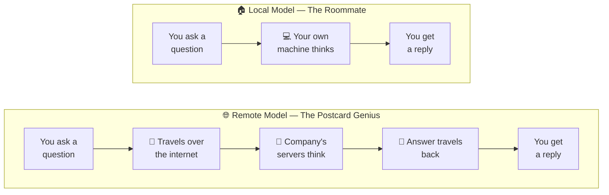

---


# Building a Local RAG Chatbot, Part 1: Local vs Remote Models (Why We're Going Local)

Picture this: you want an AI assistant. You have two choices.




**Option A:** You call up a genius who lives across the country. Every time you have a question, you write it on a postcard, mail it to them, and wait for their reply to come back. They're brilliant — but they live far away, they charge you for every postcard, and honestly, you're trusting the mail service with everything you write.

**Option B:** You hire a slightly-less-famous-but-still-pretty-smart friend who moves into your spare room. No postcards. No mail delays. No one else reads your letters. They might not know _quite_ as much as the genius, but they're always home, and they're yours.

That's the entire difference between **remote AI models** and **local AI models** — and it's the first decision we need to understand before we build anything.

By the end of this post, you'll have a real, working AI model running on your own computer, answering your questions — with zero API keys, zero internet required, and zero postcards involved.

Let's get into it.

### What Even _Is_ an AI Model?

Strip away the buzzwords, and an AI model is just this: a giant file full of learned patterns, created by feeding a computer enormous amounts of text until it gets good at predicting what word should come next. Ask it a question, and it uses those patterns to generate an answer.

That giant file has to physically live somewhere. That "somewhere" is the whole ballgame.

Here's the short version of how it gets built: the model is shown text with a word hidden, it guesses, it gets corrected, and it nudges its internal settings slightly to be less wrong next time. Do that billions of times across a massive pile of text — websites, books, code, articles, conversations — and those tiny corrections add up to something that can hold a conversation or explain the water cycle.

There's one catch: this training has a cutoff date. Once training stops, everything the model learned gets locked in and compressed into a file (called the **model weights**) — anywhere from a few gigabytes to hundreds of gigabytes. Whether that file sits on a company's server (remote) or in your own project folder (local) is exactly the choice we're exploring in this post.

## Remote Models: The Postcard Genius

When you use something like ChatGPT, Claude, or Gemini through a website or an API, here's what's actually happening:

1. You type your question.
2. It travels over the internet to a company's servers (think: a warehouse full of very powerful computers).
3. Their model — the genius — reads it, thinks, and writes a response.
4. The response travels back over the internet to your screen.

This is fantastic for a lot of reasons — those models are huge, extremely capable, and always up to date. But notice what it requires: an internet connection, and your data taking a round trip through someone else's servers. Often, it also costs money per question (or per "postcard," if we're keeping the metaphor alive).

## Local Models: The Roommate

A local model flips the whole picture. Instead of mailing your question somewhere else, the model itself lives on your machine. When you ask it something:

1. You type your question.
2. Your own computer's processor reads it and generates a response.
3. That's it. That's the whole trip.

No internet round-trip. No middleman. Nothing leaves your laptop.


## So Why Would We Choose the Roommate Over the Genius?

Let's be honest about the trade-offs — a good blog doesn't oversell things.

**Reasons to go local:**

- **Privacy** — your questions and documents never leave your machine. Huge if you're feeding it personal notes, private code, or sensitive files.
- **No cost per question** — once the model is downloaded, you can ask it a thousand things without a bill showing up.
- **Works offline** no wifi? No problem. Ever been on a flight or a train through a dead zone and wanted to ask an AI something? A local model doesn't care whether you're at 30,000 feet or in a tunnel with zero bars. It's already on your laptop, so it just answers.
- **You're in control** — no surprise model updates, no "this feature is deprecated" emails.

**The honest downside:**

- Local models are usually smaller and a bit less sharp than the biggest remote models — your roommate is smart, but they're not _that_ genius from across the country.
- You need a reasonably capable computer to run them smoothly.

For this series, we're deliberately choosing the local route — because we're going to be feeding our AI assistant _our own documents_ (that's what RAG is all about, more on that soon), and keeping everything private and running on our own machine fits that goal perfectly.


### Let's Get Our Roommate Moved In

We've covered the theory — now it's time to actually bring your roommate home and see it answer your first question, with no internet and no API key involved. 
Head over to parcticle part  [Part 2] to get your hands dirty and set this up step by step.


## Let's Get Our Roommate Moved In (Hands-On Time)

Enough talking — let's actually run a local model. We'll use a tool called **Ollama**, which makes running local AI models about as easy as installing an app.

**Step 1 — Install Ollama**

Head to [ollama.com](https://ollama.com/) and download the installer for your operating system (Mac, Windows, or Linux). Install it like any other app.

**Step 2 — Pull a small model**

Open your terminal and run:

```bash
ollama pull llama3.2
```

This downloads a small, efficient model (a few gigabytes) onto your machine. Think of this as your roommate's moving truck arriving.

**Step 3 — Ask it something**

```bash
ollama run llama3.2
```

You'll get a prompt where you can type directly. Try:

```
>>> What's the capital of France?
```

You should see it answer almost instantly — and notice: no internet spinner, no "loading," and no API key typed in anywhere. That's the whole point.

## Where This Gets Interesting

Now try asking your local model something it _can't_ possibly know — like a question about a personal document, a private project, or something very specific to you:

```
>>> Summarize the key points from my resume.
```

It'll either admit it has no idea, or — more entertainingly — confidently make something up that sounds plausible but is completely wrong. This is called **hallucination**, and it's the single biggest limitation of any AI model, local or remote.

Our roommate is smart, but they've never actually read your resume. They're guessing.

**That's exactly the gap we're going to fix in this series.** Over the next few parts, we'll teach our local model to actually _read_ your documents before answering — a technique called **RAG** (Retrieval-Augmented Generation). By the end, that same model will confidently and _correctly_ summarize your resume, your notes, or whatever you feed it.

## In Plain Terms

Remote models are powerful but live far away and cost money per question. Local models live on your machine, are private and free to run, but need a little help to know about _your_ specific stuff. That "little help" is what we're building next.

## Coming Up in Part 2

We'll take a real document and start chopping it into bite-sized pieces — a process called **chunking** — the very first step toward giving our local model a memory of your own files.

_This is Part 1 of the "Building a Local RAG Chatbot" series. All code for this series lives in [link to your repo]._